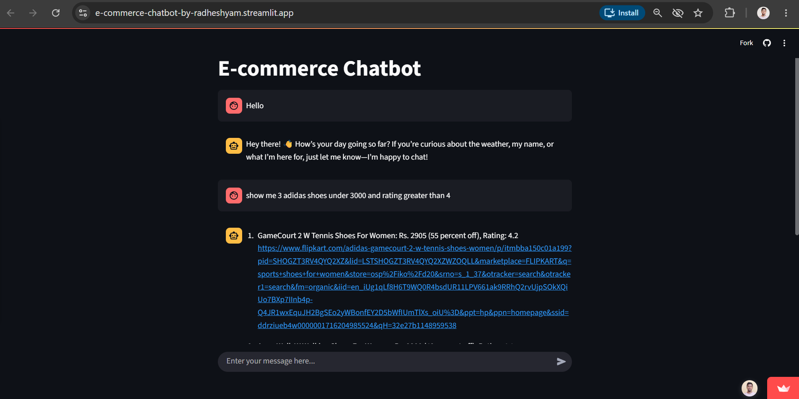
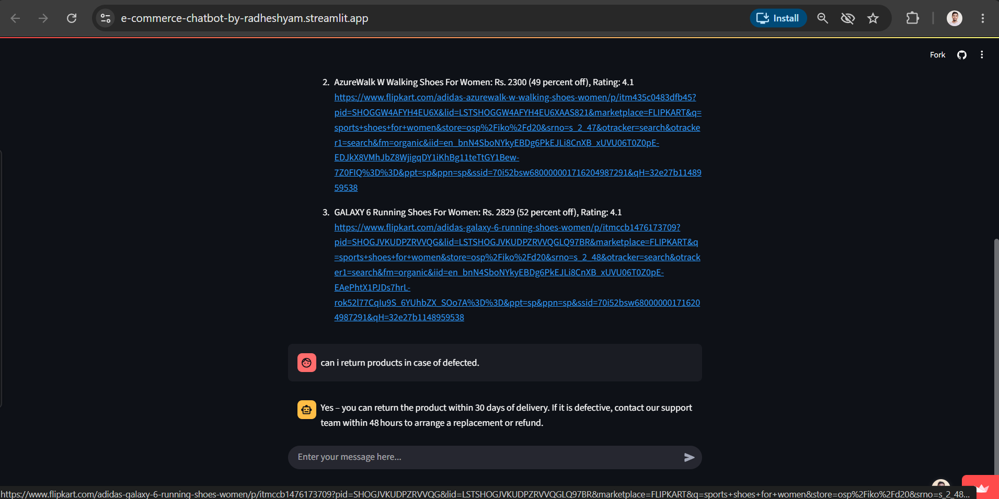
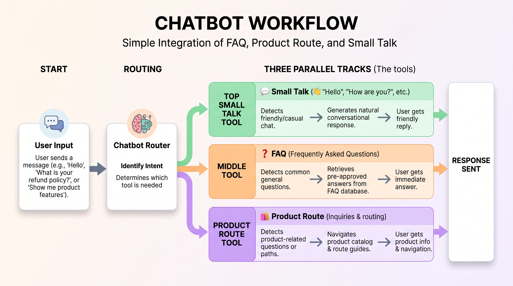

# E-commerce Chatbot

A Streamlit chatbot for answering e-commerce FAQs, finding products in a SQLite catalog, and responding to casual conversation. It uses semantic routing to select a response path, Sentence Transformers to create local embeddings, ChromaDB for FAQ retrieval, and Groq for natural-language generation.


| Resource | Link |
| --- | --- |
| Streamlit UI | https://e-commerce-chatbot-by-radheshyam.streamlit.app |
| Linkedin | https://lnkd.in/p/dcW3YD79 |

<h1 align="center">Streamlit Screenshots</h1>




<h1 align="center">Architecture</h1>



## What it does

- **Routes questions by intent:** A semantic router classifies incoming questions as FAQ, product/database, or small talk.
- **Answers FAQs:** Questions are matched against FAQ questions embedded with `sentence-transformers/all-MiniLM-L6-v2`. ChromaDB retrieves relevant entries, and Groq generates a response from their answers.
- **Searches the product catalog:** Groq generates a SQL `SELECT` query from a product question. The app runs it against SQLite, uses pandas to read the results, and asks Groq to present the results in natural language.
- **Keeps a chat transcript:** Streamlit chat messages are retained in session state for the current browser session.
- **Includes a separate data collection workflow:** A Jupyter notebook in `web_scrapping/` extracts product links and product information. It is not required to run the chatbot.

## How the application works

1. `app/main.py` displays the Streamlit chat UI and sends each message to the router.
2. `app/router.py` uses `semantic-router` and a Hugging Face sentence-transformer encoder to select a route.
3. The FAQ path in `app/faq.py` indexes `app/resources/faq_data.csv` in ChromaDB and generates an answer using the retrieved FAQ context.
4. The product path in `app/sql.py` asks Groq to generate a `SELECT` query, executes it against `app/db.sqlite`, and summarizes the returned rows.
5. The small-talk path in `app/smalltalk.py` uses Groq to produce a conversational response.

## Project structure

```text
.
├── README.md
├── requirements.txt
├── app/
│   ├── main.py                 # Streamlit UI and request dispatch
│   ├── router.py               # Semantic intent routing
│   ├── faq.py                  # FAQ embeddings, retrieval, and responses
│   ├── sql.py                  # Product SQL generation and result summaries
│   ├── smalltalk.py            # Small-talk response generation
│   ├── db.sqlite               # SQLite product catalog used by the app
│   └── resources/
│       └── faq_data.csv        # FAQ questions and answers
├── docs/
│   └── images/
│       ├── workflow_e-commerce.png    # Application architecture diagram
│       └── project_photo.png  # Replace with a real app screenshot
│        └── project_photo_1.png
└── web_scrapping/
    ├── flipkart_data_extraction.ipynb  # Optional product scraping workflow
    └── csv_to_sqlite.py                # CSV-to-SQLite utility
```

## Requirements

- Python 3.13 or newer
- A Groq API key and a model ID supported by your Groq account
- Internet access on first run to download the sentence-transformer model

The root `requirements.txt` contains the chatbot runtime dependencies. The scraper notebook has additional optional dependencies listed below.

## Run locally

Run these commands in PowerShell from the repository root:

```powershell
py -m venv .venv
.\.venv\Scripts\Activate.ps1
python -m pip install --upgrade pip
pip install -r requirements.txt
```

Create `app\.env` with your Groq credentials:

```dotenv
GROQ_API_KEY=your_groq_api_key
GROQ_MODEL=your_supported_groq_model_id
```

Keep the API key private and do not commit `app\.env`.

Start the app from the `app` directory so its local Python module imports resolve:

```powershell
Set-Location app
streamlit run main.py
```

Streamlit will print a local URL in the terminal. Open that URL in a browser to use the chat interface.

### Data files

- FAQ source data: `app\resources\faq_data.csv`
- Product database used by the chatbot: `app\db.sqlite`

The FAQ records are ingested into ChromaDB when the app starts. The product query code expects the SQLite database and its `product` table to be present.

## Optional: product scraping and CSV import

The notebook in `web_scrapping/` is a separate workflow for collecting product links and product details. To use it, install its additional packages:

```powershell
pip install selenium beautifulsoup4 lxml
```

Run the notebook in Jupyter. Scraping may require a working browser installation and may be affected by changes to the source website.

`web_scrapping/csv_to_sqlite.py` reads `web_scrapping/flipkart_product_data.csv` and writes `web_scrapping/db_1.sqlite`. The chatbot itself reads `app/db.sqlite`; the utility does not automatically replace or update that application database.

## Example questions

- “What is the return policy?”
- “How can I track my order?”
- “Show me Nike products under Rs 1000.”
- “Which products have the highest rating?”
- “Hello!”

## Configuration and implementation notes

- The semantic router and FAQ embeddings use `sentence-transformers/all-MiniLM-L6-v2`; the model may need to be downloaded the first time the app runs.
- Groq is used for FAQ response generation, product SQL generation, product-result summaries, and small talk.
- The product database is queried locally with SQLite; it is separate from the FAQ vector collection.
- The current small-talk dispatch in `app/main.py` passes the route name (`small_talk`) to the response function instead of the user's message. Pass the original query to `small_talk` for responses based on what the user actually said.
- The Streamlit demo and repository URLs at the top of this README are placeholders and should be replaced with the canonical links.
